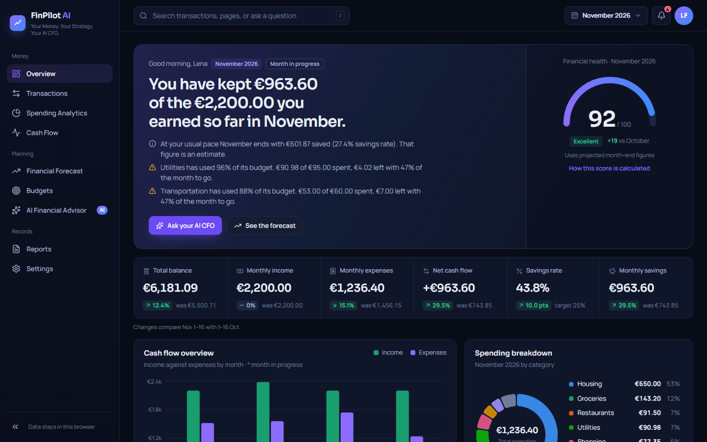
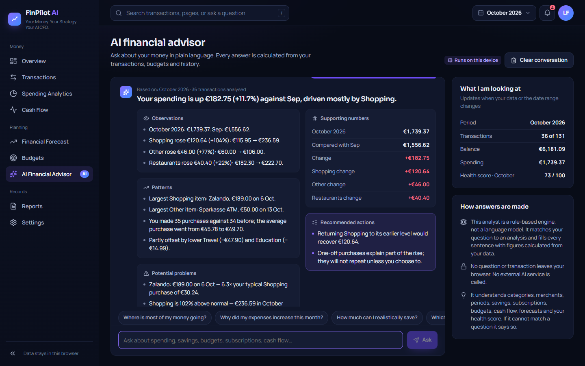
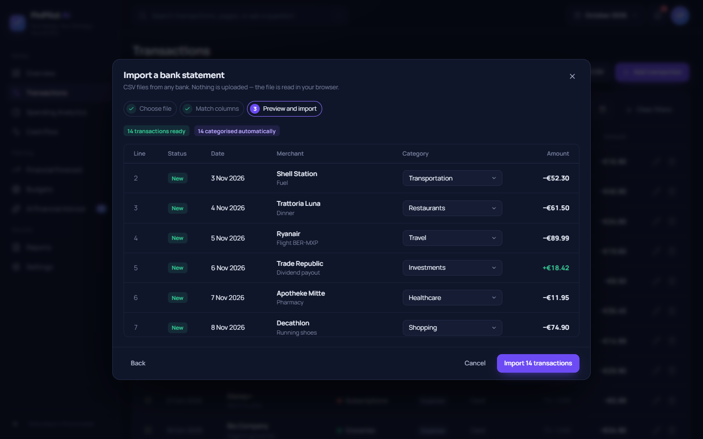
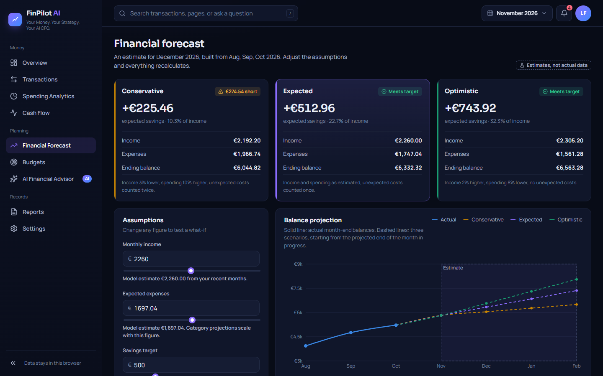
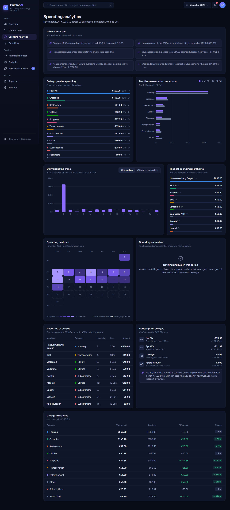
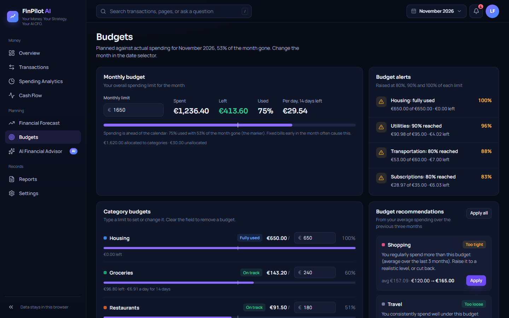
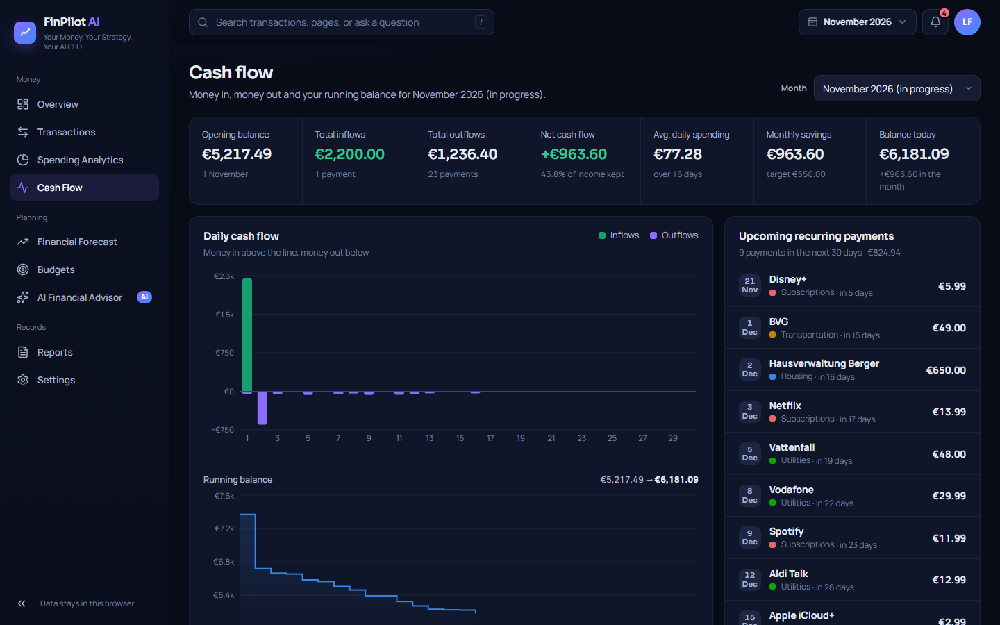
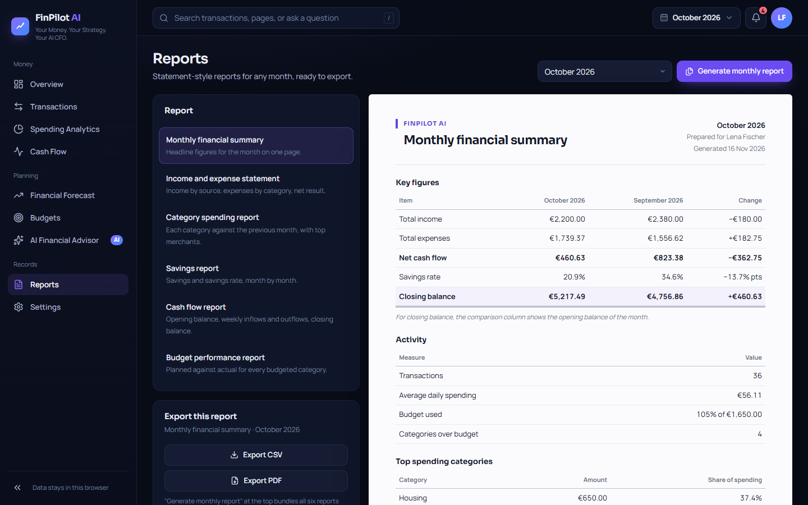

<div align="center">


# FinPilot AI

### Your Money. Your Strategy. Your AI CFO.

An intelligent personal finance platform that reads your transactions and tells you where you stand,
what changed, what is coming, and what to do about it.


<br />



</div>

<br />

## What it is

FinPilot AI is a working personal CFO, not a mock-up. Open it and it is already populated with three
months of realistic European personal finance data in euros. Add a transaction, import a bank statement
or change a budget, and every balance, chart, forecast, insight and score on every page is recalculated
from the same list of transactions.

It runs entirely in the browser. There is no server, no account and no tracking — your data is stored
locally and never leaves your device.

> **About the "AI".** FinPilot's analyst is a deterministic financial intelligence engine: real
> calculations and transparent rules applied to your own data. It does not call a language model or
> any external AI service, and it never pretends to. Every sentence it writes is assembled from
> figures it has just computed, and when it cannot match a question to an analysis it says so.

## Highlights

| | |
|---|---|
| **Executive dashboard** | A written briefing, six KPIs with like-for-like comparisons, cash flow, spending breakdown, trends, budget performance and a 0–100 financial health score. |
| **AI financial advisor** | Ask questions in plain language. Answers come as observations, supporting numbers, patterns, potential problems and recommended actions. |
| **CSV bank import** | Drop in a statement from any bank. Columns are matched automatically, transactions are categorised, duplicates are caught, and you preview everything before it is saved. |
| **Spending analytics** | Category and merchant rankings, month-over-month comparison, daily trend, calendar heatmap, recurring payments, subscription analysis and anomaly detection. |
| **Forecasting** | Next month's income, expenses, savings and ending balance in three scenarios, with assumptions you can drag to test a what-if. Estimates are always marked as estimates. |
| **Budgets** | Monthly and per-category limits with progress bars, alerts at 80%, 90% and 100%, and recommendations based on your own history. |
| **Reports** | Six statement-style reports for any month, exportable as CSV or as a formatted PDF. |

## A closer look

### AI financial advisor

Ask *"Why did my expenses increase this month?"* and the engine compares the period with the one
before it, ranks the categories that moved, finds the purchases that drove them, separates one-offs
from habits and tells you what would bring the number back.



It understands questions about categories and merchants, changes between periods, savings potential,
subscriptions, budgets, income, cash flow, month-end projections, forecasts and the health score.

### Bank statement import



- Comma, semicolon or tab separated files; headers in English, German, Italian, Spanish or French
- European (`1.234,56`, `31.12.2026`) and US (`1,234.56`, `12/31/2026`) formats, detected per file
- One signed amount column, or separate money-in and money-out columns
- Manual column mapping whenever the automatic match is wrong
- Categorisation that learns from you: a merchant you have filed before is filed the same way again
- Duplicate detection on date, amount, direction and merchant

### Forecast



### Spending analytics



### Budgets, cash flow and reports

| Budgets | Cash flow |
|---|---|
|  |  |



## Getting started

Requires [Node.js](https://nodejs.org) 20 or newer.

```bash
git clone https://github.com/iamsammy-ak/finpilot-ai.git
cd finpilot-ai
npm install
npm run dev
```

Then open the address Vite prints (usually `http://localhost:5173`).

| Command | What it does |
|---|---|
| `npm run dev` | Start the development server with hot reload |
| `npm run build` | Type-check and create a production build in `dist/` |
| `npm run preview` | Serve the production build locally |
| `npm test` | Run the engine test suite |
| `npm run typecheck` | Type-check without building |

The production build is fully static, so it can be hosted anywhere that serves files.

### Try it in two minutes

1. **Overview** — read the briefing, then follow *How this score is calculated*.
2. **Transactions → Import CSV → Try a sample statement** — watch fourteen new transactions get
   categorised, then see budgets and the health score react.
3. **AI Financial Advisor** — pick a suggested question, or type your own.
4. **Financial Forecast** — drag *Expected expenses* and watch all three scenarios move.
5. **Reports → Generate monthly report** — download the six-report PDF.
6. **Settings → Reset demo data** — put everything back.

## How the numbers are calculated

Nothing in FinPilot is hard-coded. These are the actual rules, and the same text appears inside the app.

<details>
<summary><b>Financial health score (0–100)</b></summary>

<br />

Four components, each scored 0–100 and weighted 25%.

| Component | How it is scored |
|---|---|
| **Savings rate** | Savings rate ÷ 30%, capped at 100. Saving 30% or more of income earns full marks. |
| **Budget adherence** | Starts at 100 and loses 4 points for every 1% of total category budgets overspent. Held at a neutral 50 when no budgets exist. |
| **Cash flow stability** | Up to 60 points for the share of the last six months with positive net cash flow, plus up to 40 for how little that net varies (standard deviation ÷ mean). |
| **Spending consistency** | Starts at 100 and loses 3 points for every 1% of month-to-month variation in total spending. |

Bands: 85+ excellent · 70+ strong · 55+ fair · 40+ needs attention. The app shows the contribution of
each component, explains why the score moved since the previous month, and lists what would raise it.

</details>

<details>
<summary><b>Forecast</b></summary>

<br />

For income and for every spending category:

1. Take up to the three most recent **complete** months and weight them 1 : 2 : 3, newest heaviest.
2. Add half of the average month-to-month change (a damped trend).
3. Clamp the result to within 10% of the range actually observed, so one unusual month cannot run away with it.

| Scenario | Income | Spending | Unexpected-cost buffer |
|---|---|---|---|
| Conservative | −3% | +10% | counted twice |
| Expected | as estimated | as estimated | counted once |
| Optimistic | +2% | −8% | not counted |

If the current month is still running, it is first projected to month end: what has happened so far,
plus recurring bills still due, plus your usual daily everyday spending for the days left.

</details>

<details>
<summary><b>Comparisons, recurring payments and anomalies</b></summary>

<br />

- **Fair comparisons.** A month in progress is compared with the *same days* of the previous month
  (1–16 November against 1–16 October), never a part month against a full one.
- **Recurring payments.** A merchant that charges roughly once a month, in two or more consecutive
  months, for a stable amount (within 10%) on a stable day (within 4 days).
- **Unusual purchases.** At least twice your typical (median) purchase in that category and at least
  €25 above it, ignoring recurring bills.
- **Unusual categories.** A month total 30% or more — and at least €30 — above the category's average
  for the previous three months.
- **Budget recommendations.** Suggested when a budget sits more than 10% below, or more than 25% above,
  your three-month average spend.

</details>

## Architecture

One rule holds the app together: **pages never compute their own totals.** Everything shown on screen
is read from a single `Snapshot` derived in one pass from the transaction list, so two pages can never
disagree about a number.

```
 transactions ─┐
 budgets ──────┼──▶  buildSnapshot()  ──▶  Snapshot  ──▶  every page
 settings ─────┤     (pure functions)      totals, KPIs, categories,
 date range ───┘                           recurring, anomalies, budgets,
                                           projection, forecast, health,
                                           insights, notifications
```

The engine in `src/engine` is plain TypeScript with no React and no browser APIs, which is what makes
it testable — the test suite runs it directly against the demo dataset.

```
src/
├── engine/              Financial intelligence — pure functions
│   ├── metrics.ts       Totals, categories, monthly series, balances, date ranges
│   ├── recurring.ts     Recurring payment and subscription detection
│   ├── analytics.ts     Anomaly detection and category changes
│   ├── budgets.ts       Budget status and recommendations
│   ├── forecast.ts      Month-end projection and next-month scenarios
│   ├── health.ts        Financial health score
│   ├── insights.ts      The five kinds of CFO insight
│   ├── advisor.ts       Question matching and answer generation
│   ├── reports.ts       Report definitions for screen, CSV and PDF
│   ├── snapshot.ts      Derives everything the UI shows
│   └── engine.test.ts   Test suite
├── lib/                 Dates, formatting, categorisation rules, CSV parsing, exports
├── data/demo.ts         Demo dataset, generated relative to today
├── store/useStore.ts    Persisted state (Zustand + localStorage)
├── components/          Layout, charts, forms, import wizard, shared UI
├── pages/               The nine screens
└── styles.css           Design tokens and component styles
```

### Built with

| | |
|---|---|
| **UI** | React 19, TypeScript (strict), Vite |
| **State** | Zustand with `localStorage` persistence |
| **Charts** | Recharts, plus hand-built SVG and CSS for the gauge, heatmap and bar lists |
| **Import and export** | Papa Parse, jsPDF with AutoTable (loaded only when a PDF is requested) |
| **Type** | Sora and Manrope, self-hosted — no external font requests |
| **Tests** | Vitest |

Chart colours were checked for colour-vision-deficiency separation and contrast against the app's
navy surfaces. The layout is responsive down to phone width, keyboard accessible, and respects
reduced-motion preferences.

## Demo data

The sample user earns €2,200 a month in Berlin and spends around €650 on housing, €220 on groceries,
€180 on restaurants, €120 on shopping, €90 on utilities, €85 on entertainment, €55 on transport and
€35 on subscriptions.

The dataset is generated relative to today's date, so the app always opens on a month in progress with
three complete months behind it — about 130 transactions. The amounts are hand-written rather than
random, and deliberately uneven: one month contains an expensive one-off purchase and a jump in
restaurant spending, so the anomaly detection, budget alerts and score changes have something real to
find.

## Privacy

- All data lives in your browser's local storage. Nothing is sent anywhere.
- No analytics, no cookies, no external requests — fonts are bundled with the app.
- **Settings → Download backup** saves everything as one JSON file that you can restore later or on
  another device.

## Limitations

- **One account.** Balances are tracked as a single account starting from an opening balance.
- **One currency.** You can change the currency symbol; amounts are not converted.
- **No bank connection.** Data comes in by CSV or by hand.
- **Forecasts are estimates.** They describe what your history implies, not what will happen.

FinPilot AI is a financial analysis tool, not financial advice.
